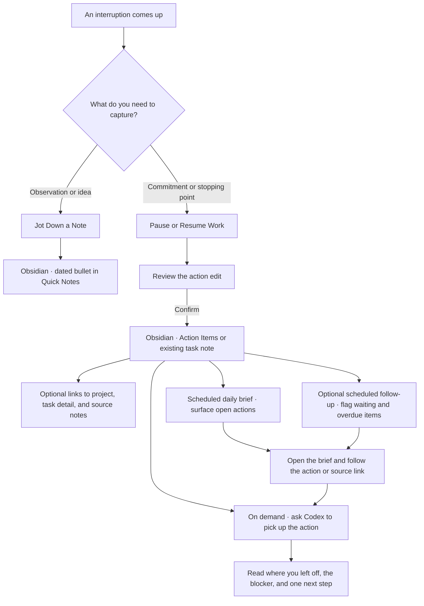
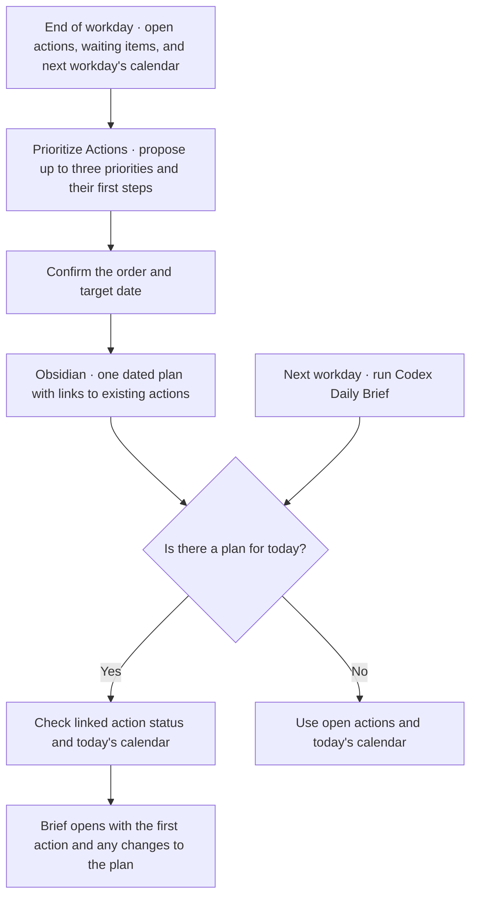
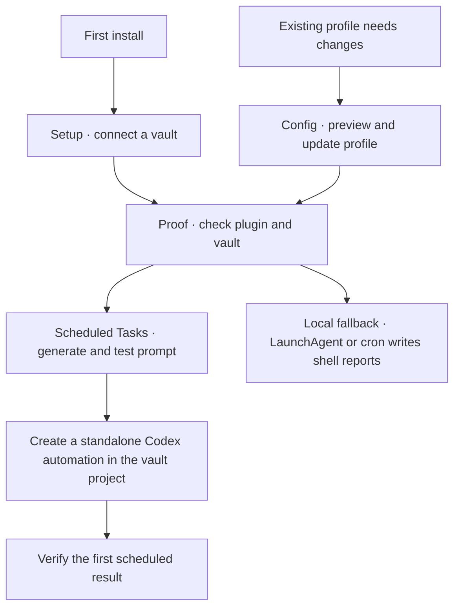
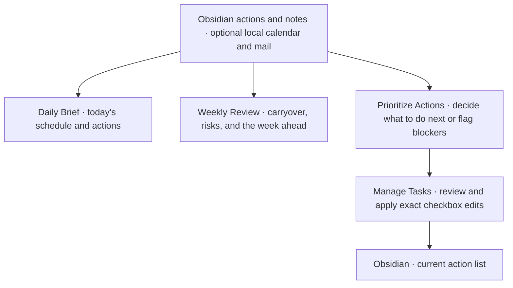
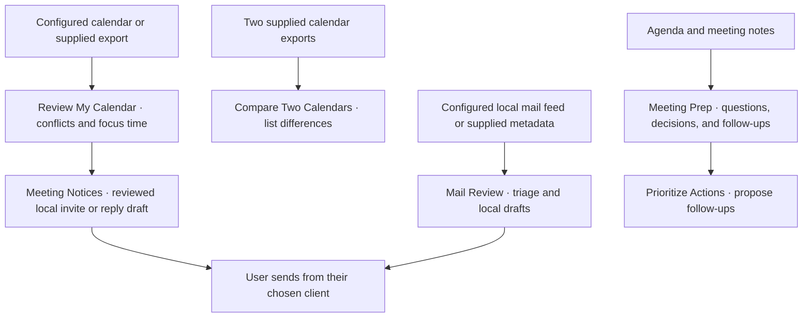
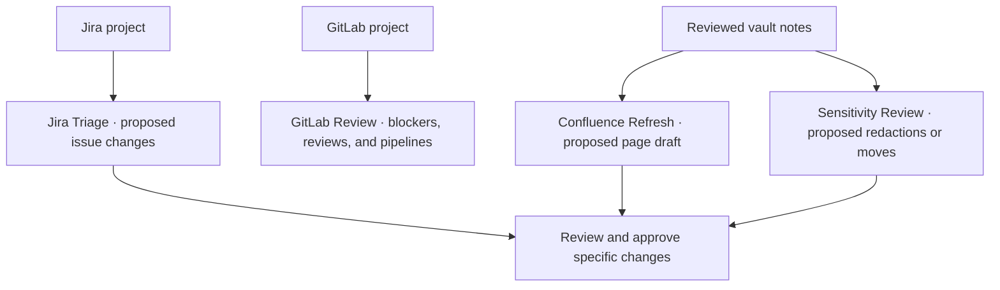

# Executive Assistant Workflows

## Find the right skill

Start with what you want to do. In a Codex chat open to your Obsidian folder,
type `$` to find a skill by name or paste a prompt from the full list below.

| What you want to do | Choose this skill |
| --- | --- |
| “Jot down that the room layout worked well.” | **Executive Jot Down a Note** · saves a short entry in Obsidian |
| “Save where I left off on the agenda” or “Pick up the agenda.” | **Executive Pause or Resume Work** · records or retrieves the next step on that action |
| “Mark the room check complete.” | **Executive Manage Tasks** · previews the change to a specific checkbox |
| “What should I work on next?” | **Executive Prioritize Actions** · ranks open work and flags blockers |
| “What needs my attention today?” | **Executive Prepare Today’s Brief** · brings actions, calendar, and available mail together |
| “Where are the conflicts on my calendar?” | **Executive Review My Calendar** · finds overlaps and suggests focus time |
| “What changed between these two exports?” | **Executive Compare Two Calendars** · lists differences for review |
| “What should I ask in this meeting?” | **Executive Prepare for or Debrief a Meeting** · pulls questions or follow-ups from notes |
| “Help me respond to this invitation.” | **Executive Draft a Meeting Invite or Reply** · prepares text you can send |

## Capture an interruption and get back to work

“Use `$executive-context-switch`. I’m pausing Friday’s agenda. Capture
‘Confirm the room for Monday’s review’ as a separate Inbox action. First
step is to check the calendar invite.”

Keep one completion checkbox per action. Use project notes for the outcome
and decisions, and add a task note when an action needs a checklist or
supporting material. Link to both from the action where useful.

The daily brief is the regular prompt to check Actions. A saved checkbox
doesn't schedule a reminder. Schedule a Codex brief or follow-up review
if you want it to surface the saved work. Open the scheduled result and
verify its links on the first run. Delivery depends on the schedule and
your notification settings.

## Close the day and plan the next one

Try this as a manual review before deciding whether to schedule it.

**End of day prompt**

> Use `$executive-action-triage` to review my open actions and the next
> workday's calendar if available. Propose up to three open actions in
> order, with links and one first step each. Show me the target date and
> plan before saving it as `notes/Work Plans/YYYY-MM-DD.md`. Use my
> intended next workday for the filename. Keep completion in the action list.

**Morning prompt**

> Use `$executive-daily-brief`. If today's dated note exists under
> `notes/Work Plans/`, open with the linked actions that are still open.
> Check today's calendar if available and flag changes that affect the plan.
> If there is no plan for today, use current vault and calendar signals.
> Save the brief in the configured vault.

These prompts illustrate a workflow to try. The stock daily schedule
prompt and the shell report have no dedicated work-plan section. To try the
morning prompt on a schedule, use it as the instruction for a standalone
Codex automation in the vault project. An end-of-day schedule could surface
a proposed plan for review. Saving the final priorities stays part of the
user's review.

## Set up and schedule

## Review the day, week, and action list

## Review calendar, mail, and meetings

## Review project and shared material

## When to use each skill

| Skill in Codex | Example request | Suggested schedule |
| --- | --- | --- |
| [Executive First-Time Setup](../plugins/executive-assistant/skills/executive-assistant-setup/SKILL.md) · `$executive-assistant-setup` | Connect this folder as my vault. | On demand |
| [Executive Change Settings](../plugins/executive-assistant/skills/executive-assistant-config/SKILL.md) · `$executive-assistant-config` | Preview a change to my vault path. | On demand |
| [Executive Check Setup](../plugins/executive-assistant/skills/executive-assistant-proof/SKILL.md) · `$executive-assistant-proof` | Check my setup in this fresh chat. | After install or a profile change |
| [Executive Pause or Resume Work](../plugins/executive-assistant/skills/executive-context-switch/SKILL.md) · `$executive-context-switch` | Save where I left off on the agenda. | On demand |
| [Executive Jot Down a Note](../plugins/executive-assistant/skills/executive-quick-note/SKILL.md) · `$executive-quick-note` | Jot down that the room layout worked well. | On demand |
| [Executive Manage Tasks](../plugins/executive-assistant/skills/executive-todo-management/SKILL.md) · `$executive-todo-management` | Preview marking the room check complete. | On demand |
| [Executive Prioritize Actions](../plugins/executive-assistant/skills/executive-action-triage/SKILL.md) · `$executive-action-triage` | Show what’s blocked, due, or waiting on someone. | Optional workday follow-up or end-of-day review |
| [Executive Prepare Today’s Brief](../plugins/executive-assistant/skills/executive-daily-brief/SKILL.md) · `$executive-daily-brief` | Save today’s brief in my vault. | Start of each workday |
| [Executive Plan the Week](../plugins/executive-assistant/skills/executive-weekly-review/SKILL.md) · `$executive-weekly-review` | Review the week and carry over open commitments. | Start of each workweek |
| [Executive Review My Calendar](../plugins/executive-assistant/skills/executive-calendar-management/SKILL.md) · `$executive-calendar-management` | Find conflicts and suggest focus time. | On demand or as part of the brief |
| [Executive Compare Two Calendars](../plugins/executive-assistant/skills/executive-calendar-sync/SKILL.md) · `$executive-calendar-sync` | Compare these two calendar snapshots. | On demand |
| [Executive Prepare for or Debrief a Meeting](../plugins/executive-assistant/skills/executive-meeting-prep/SKILL.md) · `$executive-meeting-prep` | Prepare questions for this review, or debrief these notes. | On demand |
| [Executive Draft a Meeting Invite or Reply](../plugins/executive-assistant/skills/executive-meeting-notices/SKILL.md) · `$executive-meeting-notices` | Draft a response to this invitation. | On demand |
| [Executive Review Mail or Draft a Reply](../plugins/executive-assistant/skills/executive-outlook-com/SKILL.md) · `$executive-outlook-com` | Triage my local Inbox metadata. | On demand or use the brief for a digest |
| [Executive Review Jira Issues](../plugins/executive-assistant/skills/executive-jira-triage/SKILL.md) · `$executive-jira-triage` | Review active and stale issues in this project. | On demand |
| [Executive Review a GitLab Project](../plugins/executive-assistant/skills/executive-gitlab-review/SKILL.md) · `$executive-gitlab-review` | Summarize current blockers and failed pipelines. | On demand |
| [Executive Draft a Confluence Update](../plugins/executive-assistant/skills/executive-confluence-refresh/SKILL.md) · `$executive-confluence-refresh` | Draft an update from these reviewed notes. | On demand |
| [Executive Check Notes Before Sharing](../plugins/executive-assistant/skills/executive-sensitivity-review/SKILL.md) · `$executive-sensitivity-review` | Check these notes before sharing the vault. | Before sharing |
| [Executive Schedule Briefs and Follow-Ups](../plugins/executive-assistant/skills/executive-scheduled-tasks/SKILL.md) · `$executive-scheduled-tasks` | Generate and test standalone schedule prompts. | When adding or changing a schedule |

Start with the daily brief and weekly review. Add a follow-up review if
waiting items routinely get missed. See [Scheduled Tasks](CODEX-WORKFLOWS.md#scheduled-tasks)
for setup and [the skill command guide](CODEX-WORKFLOWS.md#which-commands-the-skills-use)
for CLI equivalents.
