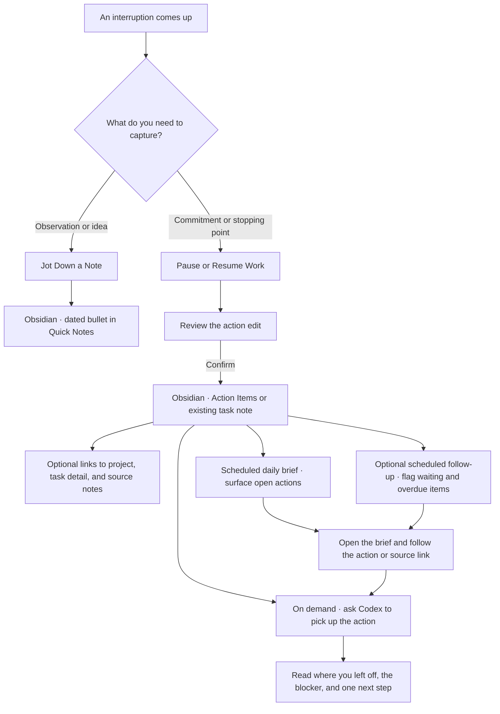
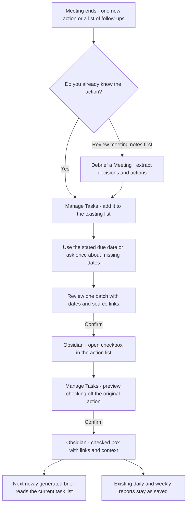
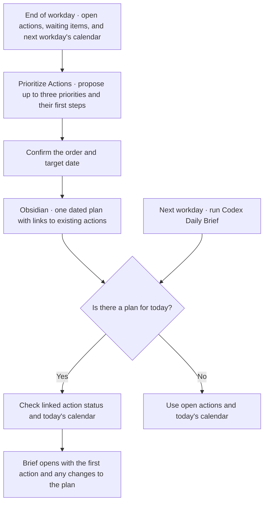
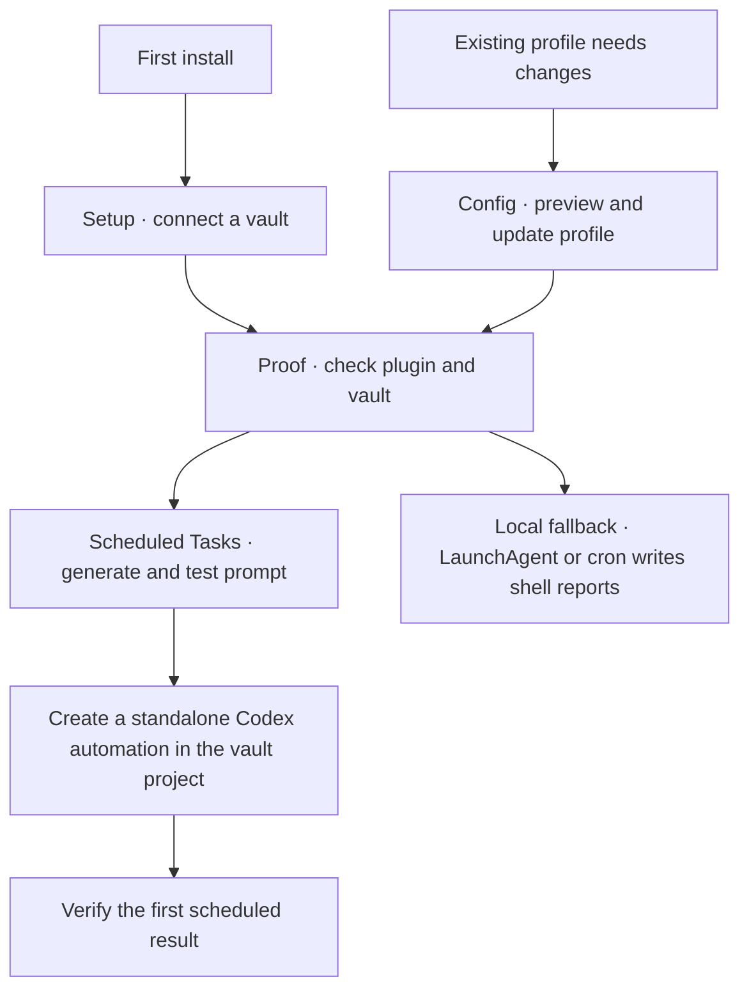
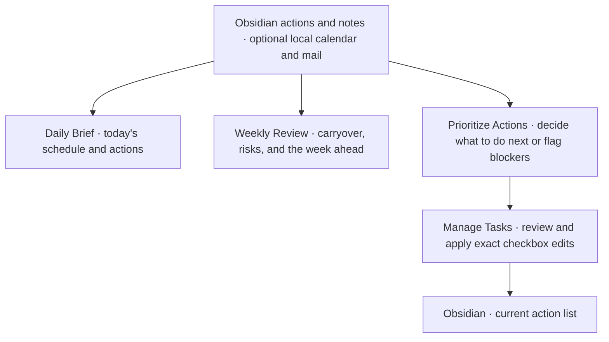
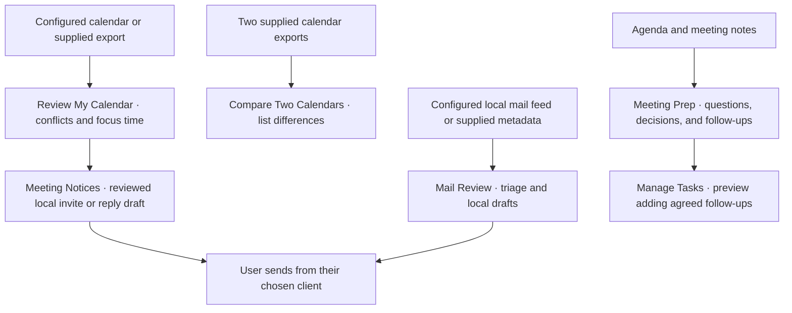
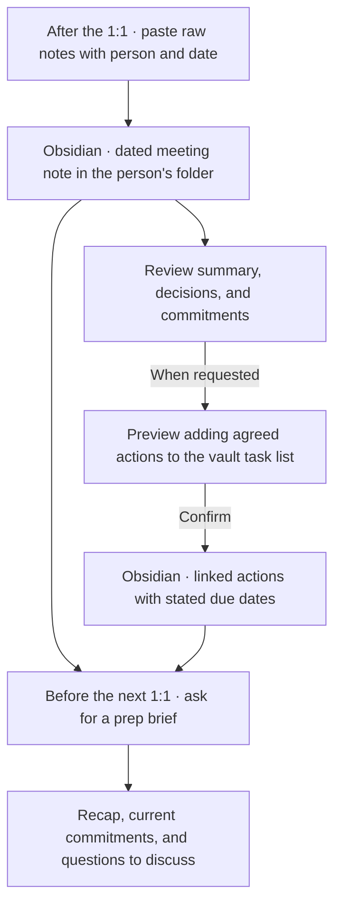
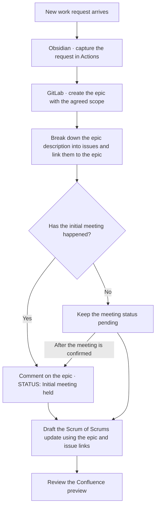
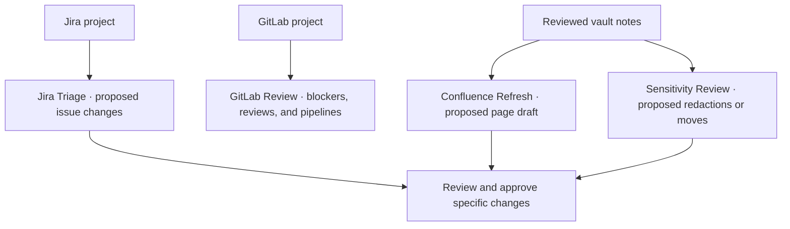

# Executive Assistant Workflows

## Find the right skill

Start with what you want to do. In a Codex chat open to your Obsidian folder,
type `$` to find a skill by name or copy a prompt from the
[sample prompt guide](SAMPLE-PROMPTS.md).

| What you want to do | Choose this skill |
| --- | --- |
| “Jot down that the room layout worked well.” | **Executive Jot Down a Note** · saves a short entry in Obsidian |
| “Save where I left off on the agenda” or “Pick up the agenda.” | **Executive Pause or Resume Work** · records or retrieves the next step on that action |
| “Mark the room check complete.” | **Executive Manage Tasks** · previews the change to a specific checkbox |
| “Add these follow-ups to my task list.” | **Executive Manage Tasks** · previews adding tasks to your existing list |
| “We received a new request for work.” | [Intake to Scrum of Scrums](#take-a-new-work-request-from-intake-to-scrum-of-scrums) · capture it, plan delivery in GitLab, and prepare the Confluence update |
| “What should I work on next?” | **Executive Prioritize Actions** · ranks open work and flags blockers |
| “What needs my attention today?” | **Executive Prepare Today’s Brief** · brings actions, calendar, and available mail together |
| “Where are the conflicts on my calendar?” | **Executive Review My Calendar** · finds overlaps and suggests focus time |
| “What changed between these two exports?” | **Executive Compare Two Calendars** · lists differences for review |
| “What should I ask in this meeting?” | **Executive Prepare for or Debrief a Meeting** · pulls questions or follow-ups from notes |
| “Help me respond to this invitation.” | **Executive Draft a Meeting Invite or Reply** · prepares text you can send |

## Capture an interruption and get back to work

1. Copy a [quick note](SAMPLE-PROMPTS.md#executive-jot-down-a-note) or
   [interruption prompt](SAMPLE-PROMPTS.md#executive-pause-or-resume-work).
2. For an action, review the target checkbox and next step, then
   [confirm the edit](SAMPLE-PROMPTS.md#start-here).
3. When you return, use the [resume prompt](SAMPLE-PROMPTS.md#executive-pause-or-resume-work)
   in the same vault project, even in a fresh chat.

Keep one completion checkbox per action. Use project notes for the outcome
and decisions, and add a task note when an action needs a checklist or
supporting material. Link to both from the action where useful.

The daily brief is the regular prompt to check Actions. A saved checkbox
doesn't schedule a reminder. Schedule a Codex brief or follow-up review
if you want it to surface the saved work. Open the scheduled result and
verify its links on the first run. Delivery depends on the schedule and
your notification settings.

## Add a meeting action and track it to completion

1. Use [Manage Tasks](SAMPLE-PROMPTS.md#executive-manage-tasks) for known
   tasks, or [Meeting Debrief](SAMPLE-PROMPTS.md#executive-prepare-for-or-debrief-a-meeting)
   to extract them from notes.
2. Review titles, due dates, and source links together. Supply a missing
   date or [approve saving the task undated](SAMPLE-PROMPTS.md#start-here).
3. Later, use the [completion prompt](SAMPLE-PROMPTS.md#executive-manage-tasks)
   and approve checking off the original task.

A newly generated brief skips checked task lines. The shell report uses
words such as “due” and “waiting” as cues, so it can still pick up those
words elsewhere in the note. It does not calculate overdue status from
dates. Ask Executive Prioritize Actions for a review against recorded dates.

### Which files change

| File in your vault | Use |
| --- | --- |
| `Action-Items.md` or your existing task list | Add actions, record due dates and next steps, and check off completed work here. |
| Meeting notes under `meetings/` | Keep the agenda, decisions, and meeting context. Link to the note from the action when available. |
| Project or task detail notes under `projects/` or `tasks/` | Keep supporting context, checklists, and files linked to the main action. Use your existing folders. |
| `notes/Quick Notes.md` or your capture note | Jot down observations and ideas. |
| `notes/Work Plans/YYYY-MM-DD.md` | Optional next-workday plan from the trial below. It links to the existing actions. |
| Reports under `_briefings/` | Read the saved daily and weekly snapshots. To see current status, follow the source link. Ask explicitly to refresh a saved report. |

## Close the day and plan the next one

Try this as a manual review before deciding whether to schedule it.

1. Use the [end-of-day prompt](SAMPLE-PROMPTS.md#executive-prioritize-actions).
   Review the date and order before saving the plan.
2. Use the [morning work-plan prompt](SAMPLE-PROMPTS.md#executive-prepare-todays-brief)
   to check which linked tasks are still open and choose where to start.

The morning work-plan prompt returns a brief in chat. To try it on a
schedule, use it in a standalone Codex automation in the vault project and
ask it to save the brief. The stock daily schedule and the shell report
have no dedicated work-plan section. An end-of-day schedule can surface
a proposed plan for your review.

## Set up and schedule

Start with [vault setup and check prompts](SAMPLE-PROMPTS.md#set-up-and-check-your-vault).
Use the [schedule prompts](SAMPLE-PROMPTS.md#set-up-scheduled-briefs) to
preview the destination and cadence, or to check an existing run.

## Review the day, week, and action list

Copy a [daily, weekly, or calendar review prompt](SAMPLE-PROMPTS.md#review-your-day-week-and-calendar).
Use [Prioritize Actions](SAMPLE-PROMPTS.md#executive-prioritize-actions)
for a focused review of the task list.

## Review calendar, mail, and meetings

Use the [meeting and mail prompts](SAMPLE-PROMPTS.md#work-with-meetings-and-email)
for prep, debrief, local mail review, or a draft reply.

## Save a one-on-one and prepare for the next meeting

Use the [one-on-one prompt sequence](SAMPLE-PROMPTS.md#executive-one-on-one)
to save the notes, confirm selected tasks, and prepare in a fresh chat.
Meeting notes go under `meetings/One-on-Ones/Person Name/YYYY-MM-DD.md`.
If you ask to save prep for a known date, it goes in a separate dated note.
Private meeting and prep notes are excluded from routine shell briefs.

## Take a new work request from intake to Scrum of Scrums

Use the Obsidian action to track intake and link it to the created epic.
Use GitLab for the epic scope, delivery issues, and status comment. Use
Confluence to share the team's update with links back to GitLab.

[Copy the step-by-step prompts](SAMPLE-PROMPTS.md#new-work-request-to-scrum-of-scrums).
`$executive-work-intake` coordinates the workflow. In a local rehearsal,
the epic and issues are linked notes in `GitLab/` and the update is a
preview note in `Confluence/` inside the selected Obsidian vault.

## Review project and shared material

See the [project and shared-notes prompts](SAMPLE-PROMPTS.md#review-project-work-and-shared-notes)
for Jira, GitLab, Confluence drafts, and sensitivity reviews.

## When to use each skill

| Skill in Codex | Example request | Suggested schedule |
| --- | --- | --- |
| [Executive First-Time Setup](../plugins/executive-assistant/skills/executive-assistant-setup/SKILL.md) · `$executive-assistant-setup` | Connect this folder as my vault. | On demand |
| [Executive Change Settings](../plugins/executive-assistant/skills/executive-assistant-config/SKILL.md) · `$executive-assistant-config` | Preview a change to my vault path. | On demand |
| [Executive Check Setup](../plugins/executive-assistant/skills/executive-assistant-proof/SKILL.md) · `$executive-assistant-proof` | Check my setup in this fresh chat. | After install or a profile change |
| [Executive Pause or Resume Work](../plugins/executive-assistant/skills/executive-context-switch/SKILL.md) · `$executive-context-switch` | Save where I left off on the agenda. | On demand |
| [Executive Jot Down a Note](../plugins/executive-assistant/skills/executive-quick-note/SKILL.md) · `$executive-quick-note` | Jot down that the room layout worked well. | On demand |
| [Executive Manage Tasks](../plugins/executive-assistant/skills/executive-todo-management/SKILL.md) · `$executive-todo-management` | Preview marking the room check complete. | On demand |
| [Executive Prioritize Actions](../plugins/executive-assistant/skills/executive-action-triage/SKILL.md) · `$executive-action-triage` | Show what’s blocked, due, or waiting on someone. | Optional workday follow-up or end-of-day review |
| [Executive Prepare Today’s Brief](../plugins/executive-assistant/skills/executive-daily-brief/SKILL.md) · `$executive-daily-brief` | Save today’s brief in my vault. | Start of each workday |
| [Executive Plan the Week](../plugins/executive-assistant/skills/executive-weekly-review/SKILL.md) · `$executive-weekly-review` | Review the week and carry over open commitments. | Start of each workweek |
| [Executive Review My Calendar](../plugins/executive-assistant/skills/executive-calendar-management/SKILL.md) · `$executive-calendar-management` | Find conflicts and suggest focus time. | On demand or as part of the brief |
| [Executive Compare Two Calendars](../plugins/executive-assistant/skills/executive-calendar-sync/SKILL.md) · `$executive-calendar-sync` | Compare these two calendar snapshots. | On demand |
| [Executive Prepare for or Debrief a Meeting](../plugins/executive-assistant/skills/executive-meeting-prep/SKILL.md) · `$executive-meeting-prep` | Prepare questions for this review, or debrief these notes. | On demand |
| [Executive One-on-One](../plugins/executive-assistant/skills/executive-one-on-one/SKILL.md) · `$executive-one-on-one` | Save my 1:1 notes with Alex, then prepare me for our next meeting. | After and before each 1:1 |
| [Executive Draft a Meeting Invite or Reply](../plugins/executive-assistant/skills/executive-meeting-notices/SKILL.md) · `$executive-meeting-notices` | Draft a response to this invitation. | On demand |
| [Executive Review Mail or Draft a Reply](../plugins/executive-assistant/skills/executive-outlook-com/SKILL.md) · `$executive-outlook-com` | Triage my local Inbox metadata. | On demand or use the brief for a digest |
| [Executive Review Jira Issues](../plugins/executive-assistant/skills/executive-jira-triage/SKILL.md) · `$executive-jira-triage` | Review active and stale issues in this project. | On demand |
| [Executive Review a GitLab Project](../plugins/executive-assistant/skills/executive-gitlab-review/SKILL.md) · `$executive-gitlab-review` | Summarize current blockers and failed pipelines. | On demand |
| [Executive Work Intake](../plugins/executive-assistant/skills/executive-work-intake/SKILL.md) · `$executive-work-intake` | Capture a request, create its epic and issues, and preview the Scrum of Scrums update. | When a new request arrives or its initial meeting is confirmed |
| [Executive Draft a Confluence Update](../plugins/executive-assistant/skills/executive-confluence-refresh/SKILL.md) · `$executive-confluence-refresh` | Draft an update from these reviewed notes. | On demand |
| [Executive Check Notes Before Sharing](../plugins/executive-assistant/skills/executive-sensitivity-review/SKILL.md) · `$executive-sensitivity-review` | Check these notes before sharing the vault. | Before sharing |
| [Executive Schedule Briefs and Follow-Ups](../plugins/executive-assistant/skills/executive-scheduled-tasks/SKILL.md) · `$executive-scheduled-tasks` | Generate and test standalone schedule prompts. | When adding or changing a schedule |

Start with the daily brief and weekly review. Add a follow-up review if
waiting items routinely get missed. See [Scheduled Tasks](CODEX-WORKFLOWS.md#scheduled-tasks)
for setup and [the skill command guide](CODEX-WORKFLOWS.md#which-commands-the-skills-use)
for CLI equivalents.
